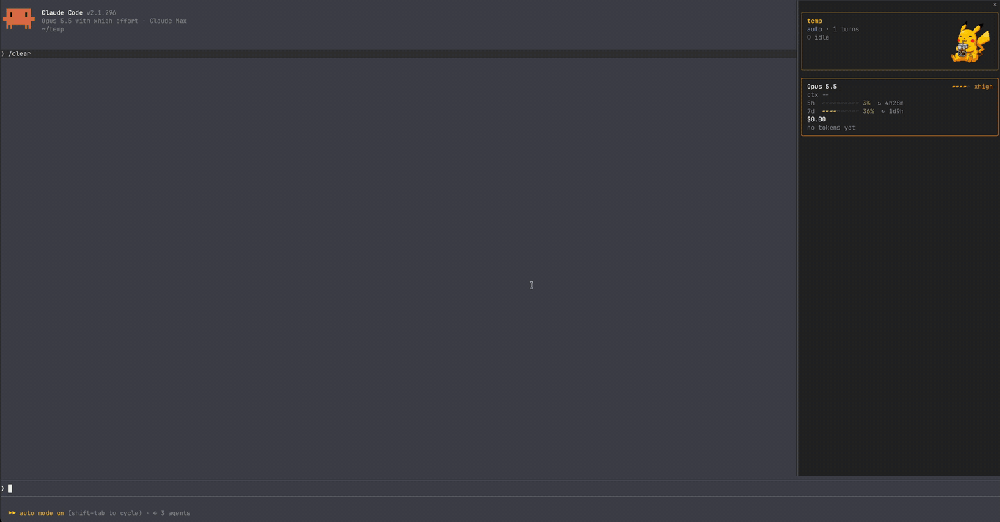

# pane-mod

[한국어](README.md) | English

A Claude Code mod that draws Claude Code's HUD in a side pane: the model and usage, the context, Claude's tasks, subagents and a work log, with a sprite of your favorite character that moves with the session's state.



## Quick start

```sh
claude plugin marketplace add taehwan0/pane-mod
claude plugin install pane-mod@pane-mod
```

Restart Claude Code and the HUD appears: in a pane on the right in the fullscreen view, above the prompt elsewhere.

For a sprite, put a character's idle and working frames (PNG) in a folder and point pane-mod at it.

```text
~/.config/pane-mod/my-character/
├── idle/     frame_001.png …    # between turns
├── working/  frame_001.png …    # a model turn under way
└── sounds/   idle/  working/    # clips per state (optional)
```

```sh
echo '{"spriteDir":"/Users/me/.config/pane-mod/my-character","soundDir":"/Users/me/.config/pane-mod/my-character/sounds"}' \
  | claude plugin configure pane-mod@pane-mod --values-stdin
```

- `/pane-mod` opens the pane; `/pane-mod auto|band|pane|hint` changes the layout for the session.
- Needs Claude Code 2.1.292 or later. Sprites were seen in Ghostty and cmux; Orca (1.4.221) does not draw them.
- The character in the demo is only an example (see "License").
- The Korean [README.md](README.md) is the primary, complete reference; this English edition covers the same features more briefly.

## Why

I mostly work on 27- and 32-inch monitors, and I like secondary information in a side panel so the main area stays wide; it is why I loved vertical-tab browsers such as Arc, Zen and Dia. Claude Code's HUD figures are always useful, but above or below the prompt they take room from where prompts and answers appear. I always wanted them out of the way, and once Claude Code's mods could draw a side pane, I moved them to the right.

## What the HUD draws

A sketch of the HUD in text.

Band (above the prompt, when no pane is shown):

```
━━━━━━━━━━━━━━━━━━━━━━━━━━━━━━━━━━━━━━━━━━━━━━━━━━━━━━━━━━━━━━━━━━━━━━━━━━━━━━━━━━━━━━━━━━  (#F7D02C)
  [sprite]  my-app(refactor/search)
  [ 10×5 ]   Opus 5.5  ▰▰▰▰▱ xhigh · $1.50                         (the model on an inverse badge)
  [      ]  ctx ▰▰▰▰▱▱▱▱▱▱ 42% · 5h ▰▰▰▰▰▰▰▱▱▱ 70% ↻2h05m · 7d ▰▱▱▱▱▱▱▱▱▱ 12% ↻3d0h
  [      ]  context 3 md (Project 2 · User 1) · hooks 3 · tools 2 · MCP 3/2srv · skills 12 · cmds 30
  [      ]  mode auto ·  ● WORKING  1m08s  ▶ Bash git status · turns 12 · style explanatory
            ↳ ● Explore  find the login bug  · 1m12s · 14 tools · Grep
```

Pane (docked on the right, cards in rounded borders):

```
╭──────────────────────────────────────────────────╮   ← border in the /color color
│ my-session                            [sprite ]  │   ← the name /rename gave
│ my-app (dev)                          [ 12×6  ]  │
│ auto · 12 turns · explanatory         [       ]  │
│  ● WORKING  1m08s                     [       ]  │   ← yellow badge
│ ▶ Bash git status · 3s                [       ]  │
│                                       [       ]  │
╰──────────────────────────────────────────────────╯
╭──────────────────────────────────────────────────╮   ← border in Claude orange
│ Opus 5.5                             ▰▰▰▰▱ xhigh │
│ ctx ▰▰▰▰▰▱▱▱▱▱ 49%  98k/200k                     │
│ 5h  ▰▰▰▱▱▱▱▱▱▱ 29%  ↻ 2h35m                      │
│     ≈ 2h05m to the 5h limit                      │   ← at this pace, until the 5h limit
│ 7d  ▰▰▰▱▱▱▱▱▱▱ 26%  ↻ 3d5h                       │
│ $16.28                                           │
│ 37.2M in · 182k out · cache 99%                  │
╰──────────────────────────────────────────────────╯
  then the tasks, subagents, context, recent, changes and log cards (in paneOrder; each only with something to show and its setting on)
```

## Requirements

- Built and tested on Claude Code 2.1.292 and later, a version that loads mods (`modules` in `hooks/hooks.json`).
- The sprite shows only where Claude Code can draw pictures: terminals that support Unicode placeholders of the kitty graphics protocol. Tested in Ghostty and cmux; the official docs say kitty 0.28 and later draws it too.
- **Orca draws no sprite as of its current version (1.4.221).** Its terminal (xterm.js) neither answers the kitty graphics query nor supports Unicode placeholders, so Claude Code draws the `alt` text instead. pane-mod notices this and gives the sprite's room to the text.
- No build step: Claude Code reads `hooks/register.tsx` as it is.
- No sprite frames or sound clips ship with it. Without them the HUD is text alone, and nothing fails. Point `spriteDir` and `soundDir` at folders of your own (see "Sprite and sound files").

## Install

The commands are in "Quick start"; [INSTALL.md](INSTALL.md) (Korean) has the settings to choose, how to check, troubleshooting, and the rules for an AI that installs it. This repository is itself a marketplace (`.claude-plugin/marketplace.json`).

With a clone, you can add its folder as the marketplace instead (`claude plugin marketplace add ~/work/pane-mod`); then `/reload-plugins` in a running session reads your edits at once. To try it for one session without installing (with pane-mod installed already, this session runs on the defaults, not the settings you chose; see "설치하지 않고 한 세션에서만 써 보기" in INSTALL.md):

```
claude --plugin-dir ~/work/pane-mod
```

### With a statusLine

A mod cannot draw in the `statusLine` area, so the HUD draws in the side pane or above the prompt. To replace a statusLine HUD, remove the `statusLine` entry from `~/.claude/settings.json` yourself; the mod never edits that file.

## Settings

Choose them as you install (INSTALL.md, chapter 2), and change them afterwards as in "Changing settings".

| Key | Default | What it does |
|---|---|---|
| `layout` | `auto` | Where the HUD draws. `auto`: the pane where the screen docks one (the fullscreen view, wide enough), the band holding nothing or one summary line; the five-row band elsewhere. `band`: the band only. `pane`: the pane always. `hint`: no band and no pane, the HUD as one line after the hint under the prompt. `/pane-mod auto`, `/pane-mod band`, `/pane-mod pane` and `/pane-mod hint` change it for the session. |
| `animate` | `true` | Animates the sprite; off, each motion holds its first frame. |
| `sprite` | `true` | Draws the sprite; off, the HUD is text alone. With no frame in the sprite folder it is left out either way. |
| `bandWithPane` | `off` | What the band draws while the pane is shown: `off` nothing, `line` a one-line summary. |
| `alerts` | `true` | Adds a line under an open approval dialog: since when it has waited, and the limit warnings standing (context and 5h at 80% and 90%, a 5h window filling before its reset). No toast, no sound (see "Alerts"). |
| `sound` | `true` | Plays a random clip from `<sound folder>/<state>/` as the state changes: `working` (a model turn starts), `idle` (it ends); a new clip stops the one still playing. macOS plays it with `afplay`; other systems play nothing. |
| `agents` | `summary` | Subagents: `summary` one line of counts, `list` one line each, `off` none. |
| `showSession` | `true` | The session rows of the pane's first card (project, branch, mode, turns, style) and the band's first row. |
| `showNow` | `true` | The status rows (the working badge and time, the tool running now). |
| `showTasks` | `true` | The tasks card (Claude's task list). |
| `showModel` | `true` | The model and its effort gauge (and the cost while totals are off). |
| `showUsage` | `true` | The context, 5h (with the pace) and 7d gauges. |
| `showTotals` | `true` | The session's cost, its input and output tokens and the cache's share. |
| `showContext` | `false` | The context card (md files, hooks, tools, MCP, skills, commands); off by default as it seldom changes. |
| `showRecent` | `true` | The recent card: the skills and MCP tools used lately. |
| `showChanges` | `true` | The changes card: the files the latest turn that changed any changed with Edit or Write, with the lines added and removed. A file's row opens its diff over the whole pane. |
| `showLog` | `true` | The log card (the work log, its detail, open as a file). |
| `logTurns` | `50` | Turns kept per session, the oldest let go of first. `0` keeps every turn; 1 to 4 count as 5. |
| `logSessions` | `30` | Sessions whose logs are kept, the most recently saved first. `0`: no limit. |
| `logDays` | `14` | Days a log is kept after its last save. `0`: no limit. |
| `paneOrder` | `tasks,agents,context,recent,changes,log` | The order of the cards under the first card and the model card, separated by commas or spaces, in any case. Unknown and repeated names are ignored, and cards not named follow in their default order, so no card goes missing; hide one with its `show…` setting. With `log` anywhere but last, the wheel does not page the log. |
| `sessionColor` | `auto` | The first card's border and the session's name. `auto` follows `/color` (a dim yellow with none); a theme key or `#rrggbb` fixes it. |
| `modelColor` | `claude` | The model card's border: a theme key or `#rrggbb`. |
| `cardColor` | `subtle` | The other cards' borders: a theme key or `#rrggbb`. |
| `barFilled` | `▰` | The character of a gauge's filled steps: one character one cell wide (no emoji, wide, space, control or combining character). |
| `barEmpty` | `▱` | The character of a gauge's empty steps, on the same terms. |
| `spriteSource` | `auto` | How frames reach the terminal: `auto` sends Ghostty and kitty the PNG's path and any other terminal its data (and switches to data once a path is refused); `file` or `bytes` fixes it. |
| `spriteDir` | (empty) | Your sprite folder. Empty: `assets/` in the plugin's folder, which the repository does not hold. |
| `soundDir` | (empty) | Your sound folder. Empty: `assets/sounds/` in the plugin's folder, which the repository does not hold. |

The theme keys are `text`, `inverseText`, `inactive`, `subtle`, `suggestion`, `remember`, `success`, `error`, `warning`, `merged`, `claude`, `permission`, `planMode`, `autoAccept`, `promptBorder`, `bashBorder`, `ide`, `diffAdded`, `diffRemoved`, `diffAddedDimmed`, `diffRemovedDimmed`, `diffAddedWord` and `diffRemovedWord`, drawn to suit your theme. An invalid color or character falls back to its default, so a typo never gets the HUD refused.

### Changing settings

| How | What it does |
|---|---|
| `/plugin configure pane-mod@pane-mod` at the prompt | Every setting on one screen; saving reloads the mod with the new values. |
| `/config` at the prompt | One setting at a time, on the pane-mod row. |
| Ask Claude | "Show the context section", "turn the sound off": Claude follows [AGENTS.md](AGENTS.md) and runs the shell command below, or tells you what to type. |
| `claude plugin configure` in a shell | As below; then type `/reload-plugins` in a running session (or restart Claude Code). |

```sh
# Current values (inputs) and the choices there are (choices)
claude plugin configure pane-mod@pane-mod --json

# Save only the keys that change (values as strings; "" for spriteDir/soundDir goes back to the default)
echo '{"showContext":"true","agents":"list"}' | claude plugin configure pane-mod@pane-mod --values-stdin
```

## Layout

| When (`layout: auto`) | What happens |
|---|---|
| Fullscreen view, wide enough | A pane (56 columns asked) docks on the right: a first card the pane's width with the session, the turn under way and a small sprite (12×6), then the model card (model, effort, usage, cost) and the tasks, subagents, context, recent, changes and log cards. The band stays empty, or holds one line with `bandWithPane: line`. |
| A narrower window, or another pane's tab in front | The pane is seen not to be placed or shown, and the band spreads into the five-row HUD. |
| Not fullscreen | No pane opens; one seated above the prompt closes, and the band draws. |
| You closed the pane | It does not open again by itself; `/pane-mod` opens it. |

### The hint layout (`layout: hint`)

- No band and no pane: the HUD is one dim line after the hint under the prompt (`? for shortcuts`, `esc to interrupt`), for when you want the figures and no room taken. For example: `? for shortcuts · ctx 42% · 5h 70% · Opus 5.5 xhigh · tasks 2/5 · subagents 1 · Bash`.
- In that order: the context's fill, the 5h window, the model and effort, Claude's tasks (done of all), the subagents running, the tool the main thread runs now. Parts with no value are left out, and Claude Code cuts the line at the terminal's edge.
- `/pane-mod` still opens the pane, which holds the HUD while it is shown.
- With no band there is no sprite; the motion sounds and the line under approval dialogs work as in the other layouts. The line shows in the terminal only.

## The work log

- **One line per finished turn**: when, how it ended (✓ answered, ⏹ stopped, ⊘ refused, ✗ failed), how long, the prompt's first words, what was done (edits, bash, reads, subagents, failed calls `err`, denied calls `denied`), output tokens and cache hits. The newest five lines show; `▲ older` / `▼ newer` (or `o` / `n` while the pane has the keyboard) page by five, and the wheel over the log, while it is the pane's last card, moves it a line a tick and leaves the pane where it is.
- **Search**: with more than five lines, a `find` field shows under the card's title. Click it, or press `s` while the pane has the keyboard, and type: the lines with every word typed (in any case) show, newest first. It searches the prompts, edited files, bash commands, tools, skills, MCP tools, subagents and failed calls. `x: clear` shows every line again. While the field has the focus every printable key goes to it; leave it with Tab, as Esc closes the pane.
- **Detail**: the `▸` before a line opens what it did in full: the prompt (up to 300 characters), edited files, commands, calls by tool, skills, MCP tools, subagents (each with how and when it ended), failed calls, approvals asked and calls denied. `c: copy prompt` copies the prompt.
- **Open as a file**: `f: open file` writes the session's log as Markdown to `~/.claude/plugins/data/pane-mod-pane-mod/logs/<session id>.md` and opens it with the system's app (`open`, else `xdg-open`).
- **Where it is kept**: one JSON file per session id in `~/.claude/plugins/data/pane-mod-pane-mod/sessions/` (under `CLAUDE_CONFIG_DIR` where that is set), written as each turn ends, with the session's color, Claude's tasks and the token totals. A session that ends while a turn runs (its terminal closed, its process signalled) keeps that turn as a stopped line. `claude -c` and `--resume` find the session's log again. `CLAUDE_PLUGIN_DATA` is followed only where it names a folder whose name begins `pane-mod-`: a Claude Code started from Claude Code's Bash tool can carry another plugin's.
- **Limits**: `logTurns`, `logSessions` and `logDays` apply as each log is saved; a file past them is removed with `/bin/rm` (or emptied where no process can run, as in the desktop app, and removed later). As Claude Code reads and writes at most 4 MiB a file, past 200 lines the oldest are sealed 200 to a file (`<id>.1.json`, `<id>.2.json`, …), never written again. Each line's fields are capped in count and length (about 17 KiB at worst, about 0.6 KiB for a usual line).
- Uninstalling the plugin clears its data folder, the logs with it; copy the folder first to keep them.

## Changes and diffs

- **The changes card** lists the files Claude changed with Edit or Write in the latest turn that changed any (subagents' included), in the order first changed, up to eight: each path from the working directory, with the lines added (green `+N`) and removed (red `-N`) since that turn began. A turn that changes nothing leaves the list as it is, the next turn to change a file starts it over, and a file changed back to how it was drops out.
- **A row opens the file's diff** over the whole pane (so do `1` to `9` while the pane has the keyboard), drawn by Claude Code's `Code` element (`format: 'diff'`) with line numbers, `+`/`-` marks, colors, and syntax highlighting by the file's extension. Its changes show with three lines around each; `w: whole file` shows the whole file with the changed lines marked, and `w: changes only` goes back. `p: prev` and `n: next` move between the files, `b: ◀ back` returns to the cards (Esc closes the pane). The wheel scrolls the pane.
- **What it compares**: the file before the turn first changed it (the tool's `originalFile`, empty for a file a Write created) with the file read back after its last change, so many edits of one file make one diff. Files changed through Bash (`sed`, formatters, `git checkout`) are not seen.
- **Limits**: the texts stay in memory only, so a reload or `/clear` empties the list, and turns of past sessions have no diff. A file over 512 KiB is listed with `?` and no diff. One diff draws up to 80,000 characters; a whole file longer than that shows its changes.

## Session name and color

The name is the one `/rename` gave (Claude Code's generated titles are not used). The color is read from `/color`'s output row, kept with the session's log and restored with `claude -c` / `--resume`; a color picked before pane-mod was installed shows once `/color` is run again. `sessionColor` fixes the first card's color whatever `/color` says.

## Alerts

pane-mod calls no one with a toast or a sound: Claude Code already shows the approval dialog, the question and the low-context warning, and a terminal's own notifications (Orca's, for one) or Claude Code's notification settings tell you when you are away, so the mod would only repeat them. What it adds is one line Claude Code does not show, under an open approval dialog (`alerts`, on by default): `pane-mod · waiting since 14:09 · ▲ context 88%`, since when the call has waited and the limit warnings standing.

| Warning | When |
|---|---|
| `▲ context 85%` | The context reaches 80% or 90%. |
| `▲ 5h 82% · resets in 1h20m` | The 5h window reaches 80% or 90%. |
| `▲ 5h limit in ~50m at this pace` | At this pace the 5h limit comes before its reset (at most every 30 minutes). |

A warning stands for a minute and is named in the line of an approval dialog open meanwhile; each mark is named once until the figure falls back under it. The pace is the mod's own arithmetic, not a model's guess: the 5h percentage read every 2 seconds, its rise over the last hour, and the time left at that rate, shown only when it comes before the reset.

## The sprite

| Claude's state | Motion |
|---|---|
| Between turns | `idle`, looped |
| A model turn under way (`turn.start` to `turn.complete`, including slash commands that open one, such as skills) | `working`, looped |
| A one-off command that opens no model turn (`/effort`, `/reload-plugins`) | stays `idle` |
| A turn's end (answered, stopped, refused, API error) | back to `idle` at once |

The `complete` motion is off for now (`IS_CHEERING` in `hooks/register.tsx`). Frames play every 80 ms (12.5 fps). [docs/sprite-states.md](docs/sprite-states.md) (Korean) lists the states that could be told apart and how to make frames.

### Sprite and sound files

No sprite frames or sound clips are in the repository. Point `spriteDir` and `soundDir` at folders of your own; the mod reads them as a session starts and uses what it finds:

```text
<sprite folder>/             # spriteDir; empty: the plugin folder's assets/
├── idle/     *.png          # between turns
├── working/  *.png          # a model turn under way
└── complete/ *.png          # a finished turn (only with IS_CHEERING on)
<sound folder>/              # soundDir; empty: the plugin folder's assets/sounds/
├── working/  *.caf, *.wav, … # a model turn starts
└── idle/     …               # a turn ends
```

- **Frames** play in name order, as many as the folder holds: number them with zeros (`frame_001.png`, `frame_002.png`, …). 220×218 RGBA PNGs are recommended.
- **Clips**: one `.caf`, `.wav`, `.aif`, `.aiff`, `.mp3`, `.m4a` or `.aac` file of the state's folder, at random; a new clip stops the one still playing.
- **Missing files**: a motion with no frames borrows another's; with none anywhere the sprite and its margins are left out. A state with no clip is silent. A file that cannot be read or played is skipped. Nothing fails.
- **After changing files**, run `/reload-plugins`: the folders are read as a session starts.
- With a clone you may also put files in its `assets/`, which `.gitignore` keeps out of commits.

### Example: your favorite character as the sprite

The demo at the top is a character's idle (between turns) and working (a model turn under way) motions, cut into frames and set as `spriteDir`, recorded through one question at 1.5× speed. As the question goes, the pane's sprite turns to its working motion beside the ` ● WORKING ` badge and the time; as the answer ends it goes back to idle, and the log card gains a line for the turn. The folder layout and the command that sets it are in "Quick start".

- The sprite was seen drawn in Ghostty and cmux.
- Orca does not draw it as of its current version (1.4.221); pane-mod then leaves the sprite's room to the text (see "Requirements").
- The character in the demo is an example. Its intellectual property belongs to its rights holders; its frames and clips are for personal use only and are not distributed (see "License").
- Keep such folders outside the plugin's data folder (`~/.claude/plugins/data/…`), which an uninstall clears.

## What it shows, and from where

| Row | What | Engine API |
|---|---|---|
| 1 | Project (branch, `⎇` in a linked worktree) | `$.session.cwd()`, `.git/HEAD` (`$.fs`) |
| 2 | Model (display name on a badge), effort (five-step gauge), session cost | `$.session.model()`, `turn.step`'s `effort`, `/effort`'s output, the settings' `modelSettings`·`effortLevel`, `usage().cost` |
| 3 | Context %, 5h and weekly limits and their resets | `usage().context`, `usage().rateLimits` |
| 4 | md files (by source), hooks, tools, MCP (servers), skills, slash commands | `usage({ breakdown: 'summary' })`, `$.settings.read()`, `$.tool.list()` |
| 5 | Permission mode, working badge and time, the tool running now, turns, output style | `classic.UserPromptSubmit`, `AbovePrompt.isWorking`, `$.session.turns()`, `prompt.compose` |
| 6~ | Subagents (counts, or one per line; an ended one counts for 30 s) | `$.agent.list()`, `tool.call`'s `agentId` |

Usage, turns and subagents are read every 2 seconds; branch, hooks, tools and md files every 15, and once more as a main turn ends. Gauges are green below 60%, yellow below 90% and red from 90%. There is no session clock and no cost per hour (it falls while a session sits idle), and no plan name (the engine does not give it).

## What this mod does on your computer

- **No network requests** (`$.http` is never called).
- **Two external programs, only**: `f: open file` opens the log's Markdown file (`/usr/bin/open`, else `xdg-open`); saving a log removes the log files past the limits with `/bin/rm -f -- <files>`, only log files in the data folder's `sessions/`. `claude plugin validate .` lists them as `$.process.run (via openLogFile, removeKept)`.
- **Slash command rows**: it reads command output rows (`session.append`, `door: 'command'`) only for `/effort`'s level, `/rename`'s name and `/color`'s color.
- **Settings hook events** (`PermissionRequest`, `Notification`, `PostToolUse`, `PostToolUseFailure`, `PermissionDenied`) are observed for the line under approval dialogs and the log, and passed on unchanged.
- **Files read**: `.git` and `HEAD`, the sprite and sound folders' listings, sprite PNGs (with the `png` source), clips from `soundDir`, its own log files and their folder, and the files Edit or Write changed (for the changes card; their text stays in memory). **Files written**: each session's log file (as a turn ends, and as a session ends mid-turn), the log's Markdown file when you ask for it, and log files emptied where `rm` cannot run.
- **The log holds** each turn's prompt (up to 300 characters, tags removed), edited file names and the first line of commands run, the first line of failed calls' errors (up to 100 characters), the targets of calls asked for or denied, calls by tool, skill and MCP tool names, subagents' types and tasks, times, token counts and cache hits, the session's color, tasks and totals. It never leaves your machine.
- **Clipboard**: written only when you press `copy prompt` (`$.ui.copy`).
- **Sprites**: Ghostty and kitty read the PNG files themselves (the `file` source); other terminals are sent each PNG's data once read (the `png` source). When the engine reports drawing the `alt` instead, a refused path switches to data, and a terminal that cannot draw pictures has the sprite hidden.
- **Environment variables read**: `TERM_PROGRAM`, `GHOSTTY_RESOURCES_DIR` and `KITTY_WINDOW_ID` (the terminal), `CLAUDE_CODE_EFFORT_LEVEL` (effort), `CLAUDE_PLUGIN_DATA`, `CLAUDE_CONFIG_DIR` and `HOME` (where logs go, and `~` in `spriteDir`/`soundDir`).

## Layout of the repository

| Path | What |
|---|---|
| `.claude-plugin/plugin.json` | Name, version, `userConfig` |
| `.claude-plugin/marketplace.json` | Makes this repository a marketplace (`source: "./"`) |
| `hooks/hooks.json` | The hooks module's path (`./register.tsx`) |
| `hooks/register.tsx` | Gathering, asset folders, sprite motions, sounds, alerts, the work log, drawing the band and the pane |
| `hooks/format.ts` | Pure functions: gauges, colors, times, git HEAD, frame and clip lists, the log's shape, search and limits, line diffs |
| `types/index.d.ts` | Shared types and the `$.state` contract |
| `tests/pane-mod.test.tsx` | Tests (`claude plugin test .`) |
| `docs/sprite-states.md` | States that could be told apart, sprites needed, how to make them (Korean) |
| `docs/demo.gif` | The demo at the top |
| `INSTALL.md`, `AGENTS.md` | Installing, and the rules for AI coding agents (Korean) |
| `CHANGELOG.md` | What changed in each version (Korean) |
| `LICENSE` | MIT |

## Development

Claude Code lays `.claude-plugin/types/` the first time it loads the mod: run `claude --plugin-dir .` once and quit, then:

```
tsc -p . --noUnusedLocals
claude plugin validate .
claude plugin test .
```

The type check needs a TypeScript that takes `target: es2023` (6.0.3 passes; 5.2.2 refuses it). A function that takes `$` must be declared at the file's top level, as the engine traces `$` calls by reading the source.

## License

The code and documents are released under the [MIT License](LICENSE). No sprite or sound ships with them; resources you supply belong to their own rights holders.

The character in the demo and the example (Pikachu) is only an example; its intellectual property belongs to Nintendo, Creatures, GAME FREAK and The Pokémon Company. Its frames and clips are fan art made for personal use, so they are not in this repository and are not distributed. Check the rights before publishing resources of a character someone else holds the rights to in a public repository or marketplace.
